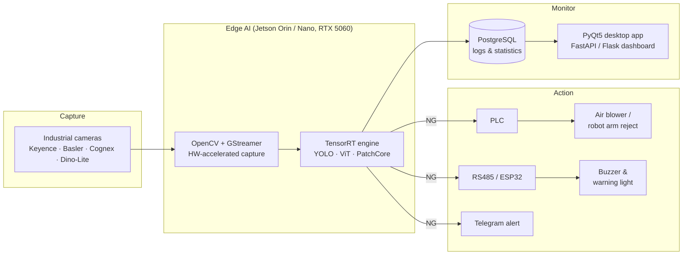

<h1 align="center">🏭 Industrial AI Vision Projects</h1>

  <b>AI visual inspection systems I built and deployed on real production lines at Hondaplus Vietnam: edge AI, industrial cameras, PLC integration</b>

  
  
  
  
  
  

> **Note:** These are industrial projects built at Hondaplus Vietnam. Source code, models and production data are proprietary, so this repository is a **technical showcase** of the systems' design, engineering and results. See the demo videos for the systems running on real production lines.

---

## 📂 Projects

| Project | Task | Stack | Details |
|---|---|---|---|
| 🍶 **MKA-B9: Bottle-Bottom Thread Inspection** | Detect ultra-thin plastic threads on bottle bottoms; PLC-triggered capture and NG reject | RT-DETRv2 (two-stage), TensorRT FP16, Jetson Orin Nano, Basler, Keyence PLC, FastAPI | [README](projects/MKA-B9-Bottle-Bottom-Thread-Inspection/README.md) |
| 👁️ **Defect Classification for Small-Scale Flaws** | Fine-grained classification of 6 defect types on eye-drop bottles | Keyence XG-X, YOLOv11, TensorRT, RTX 5060 | [Repository](https://github.com/LinhNhat07/Defect-Classification-for-Medium-and-Small-Scale-Flaws) |

More projects will be added under [`projects/`](projects/).

---

## 📌 Overview: Common Platform

The sections below describe the common platform shared by these inspection systems.

A smart quality control (QC) system that automates visual inspection on **real conveyor lines**, running 24/7. Images come straight from industrial cameras, AI models decide OK/NG on edge devices, and defective products are **removed from the line automatically** through the PLC.

The system is in production at the company in Vietnam and at its **parent company in Japan**.

## 🎯 Example Target Defects (labeling & bottle-neck lines)

| Defect | Description |
|---|---|
| Inverted label | Label rotated 180° due to feeding errors |
| Wrong label size | Label from a different SKU |
| Wrong position | Label not at the specified coordinates |
| Skew / misalignment | Tilted, off-axis or wrinkled label |
| Bottle neck thread defect | Deformed, chipped, missing or wrong-pitch threads that prevent a tight seal |

## 🏗️ System Architecture

## 🧠 Models

- **Object detection:** researched and benchmarked YOLO (v8, v11, YOLOX, YOLO-NAS), RTMDet, SSD-MobileNet and RT-DETR (RT-DETRv2 in production on MKA-B9)
- **Anomaly detection:** **PatchCore** for cases where defect samples are rare
- **Segmentation:** **DeepLabV3** with ResNet / ViT backbones
- **Classification:** ResNet, CNN and Vision Transformer, with YOLO + ViT ensembles on complex lines

## ⚡ Edge Optimization

| Step | Purpose |
|---|---|
| PyTorch / TensorFlow → **ONNX** | Framework-independent, optimized compute graph |
| ONNX → **TensorRT `.engine`** | Kernels tuned for NVIDIA Tensor Cores |
| **FP16 / INT8** quantization | Smaller model, faster inference on embedded devices |

| Platform | Role |
|---|---|
| NVIDIA Jetson Orin | YOLO + ViT ensembles on complex lines |
| NVIDIA Jetson Nano / Raspberry Pi | Lightweight engines for simpler tasks |
| RTX 5060 workstation | Training, data management, high-resolution inference |

## 📊 Results

| Metric | Value |
|---|---|
| Accuracy (mAP@50) | **0.89 – 0.99** depending on product and defect type |
| Inference latency | **< 20 ms** per product (TensorRT) |
| Environment | Real conveyor lines, 24/7, with industrial vibration and changing light |

**Precision is prioritized** so that good products are not rejected and the line is not stopped unnecessarily.

## 🗂️ Data

- Collected directly from cameras on the production line to capture real conditions (changing light, mechanical vibration, translucent plastic bottles)
- Noise filtering and manual labeling to build a high-quality ground-truth dataset
- Augmentation that simulates rare defects to handle class imbalance

## ⚠️ Technical Challenges

- **Hardware limits:** running heavy models (ViT / ResNet) smoothly on Jetson Nano
- **Tiny defects:** thread defects are very small and need high-resolution cameras and sensitive models
- **Real-time sync:** getting the AI decision to the mechanical rejector in time on a moving conveyor

## 🛠️ Tech Stack

`Python` · `PyTorch` · `TensorFlow` · `OpenCV` · `GStreamer` · `ONNX Runtime` · `TensorRT` · `PostgreSQL` · `PyQt5` · `FastAPI` · `Flask` · `Docker` · `PLC` · `RS485` · `ESP32` · `Telegram API`

## 👤 Author

**Nguyen Hong Nhat Linh** – AI Engineer · [GitHub](https://github.com/LinhNhat07) · nlinh.nh7@gmail.com
