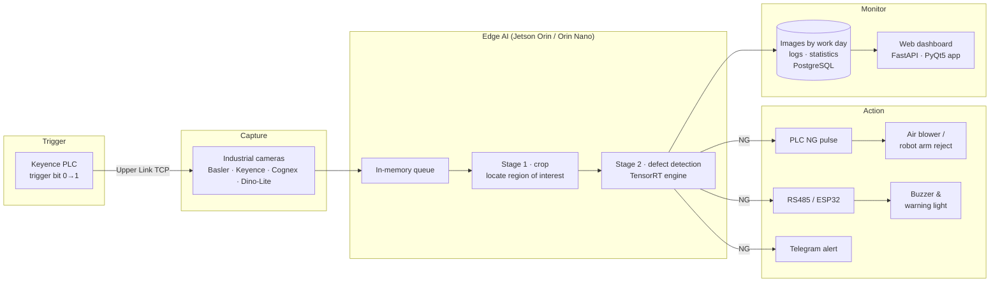

<h1 align="center">🏭 Industrial AI Visual Inspection System</h1>

  <b>Real-time AI quality inspection with automatic defect rejection on production lines, running on NVIDIA Jetson edge devices</b>

  
  
  
  
  
  
  

> **Note:** Built at Hondaplus Vietnam. The source code, models and production data are proprietary, so this repository is a **technical showcase** of the system's design, engineering and results. See the demo videos for the system running on real production lines.

---

## 📌 Overview

A smart quality control system that automates visual inspection on **real conveyor lines**, running 24/7:

1. The **PLC** signals that a product is in position.
2. An **industrial camera** captures a high-resolution image.
3. AI models on an **edge device** decide **OK / NG** in real time.
4. NG is sent back to the **PLC**, which removes the product with an air blower or robot arm.
5. Every image, result and statistic is stored per work shift and shown on a **live web dashboard** that any PC on the LAN can open.

The system is in production at the company in Vietnam and at its **parent company in Japan**.

## 🎯 Target Defects

| Defect | Description |
|---|---|
| Plastic thread (fiber) | Ultra-thin plastic fibers left on the bottle bottom after molding: tiny compared to the full frame and hard to see by eye |
| Bottle neck thread defect | Deformed, chipped, missing or wrong-pitch threads that prevent a tight seal |
| Inverted label | Label rotated 180° due to feeding errors |
| Wrong label size | Label from a different SKU |
| Wrong position | Label not at the specified coordinates |
| Skew / misalignment | Tilted, off-axis or wrinkled label |

## 🏗️ System Architecture

## 🧠 Models

- **Two-stage detection for tiny defects:** a first **RT-DETRv2** model locates and crops the region of interest from the full 3840 × 2748 frame, and a second RT-DETRv2 model searches the crop for defects. Removing the background makes a tiny defect take up much more of the model input. The two models live in separate folders so a crop model can never be loaded into the defect step by mistake.
- **Object detection:** researched and benchmarked YOLO (v8, v11, YOLOX, YOLO-NAS), RTMDet, SSD-MobileNet and RT-DETR
- **Anomaly detection:** **PatchCore** for cases where defect samples are rare
- **Segmentation:** **DeepLabV3** with ResNet / ViT backbones
- **Classification:** ResNet, CNN and Vision Transformer, with YOLO + ViT ensembles on complex lines

## ⚡ Edge Inference Engineering

### Optimization pipeline

| Step | Purpose |
|---|---|
| PyTorch / TensorFlow → **ONNX** | Framework-independent, optimized compute graph |
| ONNX → **TensorRT `.engine`** | Kernels tuned for NVIDIA Tensor Cores |
| **FP16 / INT8** quantization | Smaller model, faster inference on embedded devices |

### Implementation details
- **Three interchangeable backends:** PyTorch `.pth`, ONNX Runtime `.onnx` and TensorRT `.engine`, behind one interface, so the application does not care which one is loaded.
- **One-click TensorRT export (FP16) from the dashboard.** Each engine gets a metadata file (GPU, TensorRT version, OS, input size, class names), so loading an engine on the wrong device gives a clear "rebuild on this device" message instead of a cryptic deserialization error.
- **Zero per-frame GPU allocation:** input/output buffers are allocated once at load time. Frames go through a pinned host buffer on a dedicated CUDA stream; color conversion, layout change, normalization and post-processing (sigmoid → top-K → boxes) all run on the GPU, and only the final boxes are copied back to the CPU.
- **Training-consistent preprocessing:** resizing uses exactly the same OpenCV interpolation as in training, because a small preprocessing mismatch silently drops detections.

### Platforms

| Platform | Role |
|---|---|
| NVIDIA Jetson Orin / Orin Nano Super (JetPack 6) | Production inference next to the line |
| NVIDIA Jetson Nano / Raspberry Pi | Lightweight engines for simpler tasks |
| RTX 5060 workstation | Training, data management, high-resolution inference |

## 📷 Capture and PLC Integration

- **PLC-triggered capture on the rising edge (0 → 1).** One persistent Keyence Upper Link connection is polled every 50 ms. This avoids using up the PLC's limited connection slots, and capturing on the edge (not the level) gives exactly one image per product. An optional auto-reset to 0 gives the ladder program a "capture done" handshake.
- **In-memory "detect directly" pipeline:** frame → RAM → queue → model → result pushed to the browser. This skips the original route (PNG encode, write to disk, folder scan every 1.2 s, 0.6 s settle wait, decode) for each ~10 MB frame.
- **Folder-watch mode** for external capture software: a file is processed only after its size stays the same across two checks, so half-written images are never read.
- **Hardware-accelerated capture** with OpenCV and GStreamer; Basler cameras through pypylon.
- **Alerts:** NG pulse to the PLC for rejection, buzzer and warning light over RS485 / ESP32, instant Telegram notifications.

## 🖥️ Monitoring Dashboard

- **One web page for the whole machine:** live image with bounding boxes, OK/NG and per-class statistics for the work day, recent NG gallery, logs, camera and PLC settings, model selection and TensorRT export.
- **Two access levels enforced on the server:** the edge device itself has full control. Every other PC on the LAN is **view-only**: it can watch the line, run a test detection or download images, and every other write request returns `403`. Engineers can be granted edit rights by IP.
- **PyQt5 desktop app** and FastAPI / Flask web apps for operation; defect logs and statistics in **PostgreSQL**.
- **Desktop launcher** for operators: one double-click starts the server, waits for the models to load and opens the dashboard.

## 🔒 Production Reliability

- **Work-day logic (06:00 → 06:00):** image folders, logs and statistics roll over at shift change, not at midnight. Counters are saved to disk, so a restart does not reset the day's numbers.
- **Memory stability on 24/7 runs:** limited glibc malloc arenas and an mmap threshold for large buffers stop RAM from slowly creeping up after hours of 10–30 MB frame allocations on the Jetson.
- **Camera auto-recovery:** if the camera is busy or disconnected, the system keeps retrying in the background and shows the reason on the dashboard.
- **Safe model updates without code changes:** copy the new checkpoint → export to TensorRT on the device → validate on known OK/NG images → switch from the dashboard.
- **Documentation:** an 85-page manual with an operator part and a technician part (installation, TensorRT on JetPack, network storage, model updates, troubleshooting).

## 📊 Results

| Metric | Value |
|---|---|
| Accuracy (mAP@50) | **0.89 – 0.99** depending on product and defect type |
| Inference latency | **< 20 ms** per product (TensorRT) |
| Camera resolution | Up to **3840 × 2748** |
| Environment | Real conveyor lines, 24/7, with industrial vibration and changing light |

**Precision is prioritized** so that good products are not rejected and the line is not stopped unnecessarily.

## 🗂️ Data

- Collected directly from cameras on the production line to capture real conditions (changing light, mechanical vibration, translucent plastic bottles)
- Noise filtering and manual labeling (Roboflow, COCO format) to build a high-quality ground-truth dataset
- Augmentation that simulates rare defects to handle class imbalance

## ⚠️ Technical Challenges

- **Tiny defects in huge images:** plastic fibers and thread defects take up a tiny fraction of a 10 MP frame. This was solved with two-stage crop → detect.
- **Hardware limits:** running heavy models (ViT / ResNet / RT-DETR) in real time on Jetson devices
- **Real-time sync:** getting the AI decision to the mechanical rejector in time on a moving conveyor
- **Long-running stability:** keeping memory, camera and PLC connections healthy across days of non-stop operation

## 🛠️ Tech Stack

`Python` · `PyTorch` · `TensorFlow` · `RT-DETRv2` · `YOLO` · `OpenCV` · `GStreamer` · `ONNX Runtime` · `TensorRT` · `CUDA` · `FastAPI` · `Flask` · `PyQt5` · `PostgreSQL` · `pypylon` · `Keyence PLC (Upper Link)` · `RS485` · `ESP32` · `Telegram API` · `Docker`

## 🔗 Related

- [Defect Classification for Medium and Small-Scale Flaws](https://github.com/LinhNhat07/Defect-Classication-for-Medium-and-Small-Scale-Flaws): Keyence XG-X + YOLOv11 hybrid inspection

## 👤 Author

**Nguyen Hong Nhat Linh** – AI Engineer · [GitHub](https://github.com/LinhNhat07) · nlinh.nh7@gmail.com
