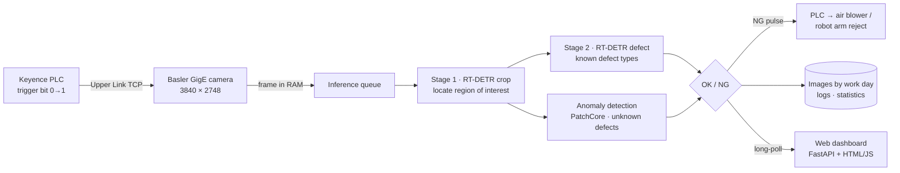
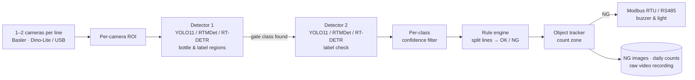

<h1 align="center">🏭 Industrial AI Visual Inspection System</h1>

  <b>Real-time AI quality inspection for bottle production lines: appearance defects and label errors, running on NVIDIA Jetson edge devices</b>

  
  
  
  
  
  
  

> **Note:** Built at Hondaplus Vietnam. The source code, models and production data are proprietary, so this repository is a **technical showcase** of the system's design, engineering and results. See the demo videos for the system running on real production lines.

---

## 📌 Overview

The system covers **two inspection problems** on bottle production lines:

| # | Problem | What it catches | Core approach |
|---|---|---|---|
| 1 | [**Appearance inspection**](#1--appearance-inspection-defects--foreign-objects) | Defects and foreign objects on the bottle: plastic threads/fibers, foreign particles, neck thread defects | Two-stage **RT-DETRv2** (crop → detect) + **anomaly detection (PatchCore)**, TensorRT FP16, PLC-triggered capture and reject |
| 2 | [**Label inspection**](#2--label-inspection-skewed--inverted-labels) | Skewed, inverted, misplaced or wrong labels | Cascaded detectors (**YOLO11 / RTMDet / RT-DETR**) on **Basler** cameras, rule-based OK/NG via split lines, object tracking, Modbus alarm |

Both run 24/7 on edge devices next to the line, decide **OK / NG** in real time, trigger rejection or alarms, and keep per-day images, logs and statistics.

The systems are in production at the company in Vietnam and at its **parent company in Japan**.

---

## 1 · Appearance Inspection (defects & foreign objects)

### Problem

During molding, bottles can carry ultra-thin plastic **threads (fibers)**, **foreign particles** or **neck thread defects** (deformed, chipped, missing or wrong-pitch threads that prevent a tight seal). These defects are tiny compared to the full frame and hard to see by eye, and every affected bottle must be rejected before packing.

### Pipeline

### Models
- **Two-stage detection for tiny defects:** an **RT-DETRv2** model locates and crops the region of interest from the full 10 MP frame, then a second RT-DETRv2 model searches the crop for known defect types. Removing the background makes a tiny defect take up much more of the model input. The two models live in separate folders so a crop model can never be loaded into the defect step by mistake.
- **Anomaly detection for rare and unknown defects:** defect samples on a production line are scarce, and new defect types keep appearing. **PatchCore** (and similar unsupervised methods) learns only from **OK products** and flags any region that deviates from normal appearance, producing an anomaly score and heatmap. It catches foreign objects and defects that the detector was never trained on, and the anomaly models can be exported to ONNX for deployment.
- **Detector + anomaly combined:** the detector names the defect type with high precision, and the anomaly model acts as a safety net for anything unusual.
- Also researched and benchmarked YOLO (v8, v11, YOLOX, YOLO-NAS), RTMDet and SSD-MobileNet, and **DeepLabV3** segmentation (ResNet / ViT backbones).

### Edge inference engineering
- **Three interchangeable backends:** PyTorch `.pth`, ONNX Runtime `.onnx` and TensorRT `.engine`, behind one interface.
- **One-click TensorRT export (FP16) from the dashboard.** Each engine gets a metadata file (GPU, TensorRT version, OS, input size, class names), so loading an engine on the wrong device gives a clear "rebuild on this device" message.
- **Zero per-frame GPU allocation:** buffers are allocated once at load time. Frames go through a pinned host buffer on a dedicated CUDA stream; color conversion, normalization and post-processing (sigmoid → top-K → boxes) all run on the GPU.
- **Training-consistent preprocessing:** resizing uses exactly the same OpenCV interpolation as in training, because a small mismatch silently drops detections.

### Capture and PLC integration
- **PLC-triggered capture on the rising edge (0 → 1)** over one persistent Keyence Upper Link connection polled every 50 ms. This gives exactly one image per product without using up the PLC's limited connection slots.
- **In-memory "detect directly" pipeline:** frame → RAM → queue → model → browser. This skips the original route of PNG encode, write to disk, folder scan, settle wait and decode for each ~10 MB frame.
- **Folder-watch mode** for external capture software: a file is processed only after its size stays the same across two checks, so half-written images are never read.

### Monitoring and reliability
- **Web dashboard:** live image with bounding boxes, OK/NG and per-class statistics, recent NG gallery, logs, camera and PLC settings, model selection and TensorRT export.
- **Server-enforced access control:** the edge device has full control. Every other PC on the LAN is **view-only**, and write requests from those PCs return `403`.
- **Work-day logic (06:00 → 06:00)** for image folders, logs and statistics. Counters survive restarts.
- **24/7 memory stability** with tuned glibc malloc arenas, plus **camera auto-recovery**.
- **Model updates without code changes:** export to TensorRT on the device → validate on known OK/NG images → switch from the dashboard.
- An **85-page manual** for operators and technicians.

---

## 2 · Label Inspection (skewed & inverted labels)

### Problem

Labels can be **inverted** (rotated 180° by feeding errors), **skewed / misaligned**, **misplaced**, or from the **wrong SKU**. A wrong label on a pharmaceutical or cosmetic bottle is a critical defect, and different product lines each have their own label layout.

| Defect | Description |
|---|---|
| Inverted label | Label rotated 180° due to feeding errors |
| Skew / misalignment | Tilted, off-axis or wrinkled label |
| Wrong position | Label not at the specified height / side of the bottle |
| Wrong label | Label from a different SKU |

### Pipeline

### Models
- **Object detectors:** **YOLO11** (Ultralytics), **RTMDet** (MMDetection) and **RT-DETR**, trained and benchmarked for each product. The detector is chosen per line based on the accuracy / speed trade-off on the target device.
- **ONNX export** for deployment, so the same pipeline can run any of the three model families.

### Cameras
- **Basler industrial cameras** (pypylon) for high-resolution, stable capture on fast lines
- **Dino-Lite / USB cameras** for close-up views and quick setup
- 1–2 cameras per line, each with its own ROI, rules and counters

### How OK / NG is decided
- **Cascaded models with gating:** a second detector runs only when the first one finds a required "gate" class (for example a correctly seated bottle neck). This saves compute on Jetson and avoids judging bottles that are only partly in view.
- **Detected parts:** the models detect the label regions that matter for each product, such as the front label (OK / NG), info panel, neck, QR code and recycle mark.
- **Configurable rule engine instead of hard-coded logic:** each class gets a rule, either `always_ok`, `always_ng`, or `line_check`. With `line_check`, the detection center is compared with a **horizontal and/or vertical split line**, and each side maps to OK / NG / IGNORE. For example, if the label part that should be at the top is found below the line, the label is inverted. Supporting a new product only takes a configuration change, not new code.
- **Per-class or global confidence thresholds**, so rare but critical classes can use their own threshold.

### Counting and traceability
- **Lightweight centroid tracker + count zone:** each bottle gets an ID as it moves through the ROI and is counted only once when its center enters the count zone. Each NG bottle is saved only once (separately for *inverted* and *skewed*), even though it appears in many frames.
- **Daily log** with per-camera counts and NG totals, restored automatically if the app restarts on the same day.
- **Raw data recording** of camera images and video during production, used to collect new training data.

### Operation
- **Product profiles:** operators click a product name and the app loads that product's models, ROI, split lines, rules and thresholds. Profiles can be added in the UI; deleting one requires a password.
- **Modbus RTU over RS485:** turns on the buzzer and warning light on NG, reads digital-input sensors, and has a manual buzzer stop.
- **PyQt5 desktop app** with drag-to-edit ROI, live overlay and statistics.
- **Cross-platform video backends:** FFmpeg / MSMF on Windows, and FFmpeg / GStreamer on Jetson, with automatic fallback when a backend is not available.
- **Trilingual operator guide (Vietnamese / English / Japanese)** for the deployment at the parent company in Japan.

### Data pipeline
1. Record line video from the inspection cameras.
2. Extract frames at a chosen target FPS.
3. **Model-assisted auto-labeling:** a trained YOLO model pre-labels new frames (keeping the best box per class), images are converted to grayscale to be robust to lighting and label color, and a YOLO dataset with a train/val split is generated automatically.
4. Review the labels, then retrain the detectors (YOLO11 / RTMDet / RT-DETR) for each product.

---

## 📊 Results

| Metric | Value |
|---|---|
| Accuracy (mAP@50) | **0.89 – 0.99** depending on product and defect type |
| Inference latency | **< 20 ms** per product (TensorRT) |
| Camera resolution | Up to **3840 × 2748** |
| Environment | Real conveyor lines, 24/7, with industrial vibration and changing light |

**Precision is prioritized** so that good products are not rejected and the line is not stopped unnecessarily.

## ⚡ Edge Platforms

| Platform | Role |
|---|---|
| NVIDIA Jetson Orin / Orin Nano Super (JetPack 5 / 6) | Production inference next to the line |
| NVIDIA Jetson Nano / Raspberry Pi | Lightweight engines for simpler tasks |
| RTX 5060 workstation | Training, data management, high-resolution inference |

Models are optimized with **ONNX → TensorRT `.engine`** and **FP16 / INT8** quantization.

## ⚠️ Technical Challenges

- **Tiny defects in huge images:** plastic fibers take up a tiny fraction of a 10 MP frame. Solved with two-stage crop → detect.
- **Few defect samples:** NG products are rare and new defect types appear over time. Solved with PatchCore anomaly detection trained only on OK products.
- **Many products, one system:** each product has a different label layout. Solved with product profiles and a configurable rule engine instead of per-product code.
- **Counting each bottle once:** a bottle appears in dozens of frames. Solved with tracking and a count zone.
- **Hardware limits:** real-time RT-DETR / YOLO on Jetson devices.
- **Long-running stability:** keeping memory, camera, PLC and Modbus connections healthy across days of non-stop operation.

## 🛠️ Tech Stack

`Python` · `PyTorch` · `RT-DETRv2` · `YOLO11 (Ultralytics)` · `RTMDet (MMDetection)` · `PatchCore (anomaly detection)` · `OpenCV` · `GStreamer` · `ONNX Runtime` · `TensorRT` · `CUDA` · `FastAPI` · `PyQt5` · `pypylon (Basler)` · `Keyence PLC (Upper Link)` · `pymodbus (Modbus RTU / RS485)` · `ESP32` · `Telegram API` · `PostgreSQL` · `Docker`

## 🔗 Related

- [Defect Classification for Medium and Small-Scale Flaws](https://github.com/LinhNhat07/Defect-Classication-for-Medium-and-Small-Scale-Flaws): Keyence XG-X + YOLOv11 hybrid inspection

## 👤 Author

**Nguyen Hong Nhat Linh** – AI Engineer · [GitHub](https://github.com/LinhNhat07) · nlinh.nh7@gmail.com
