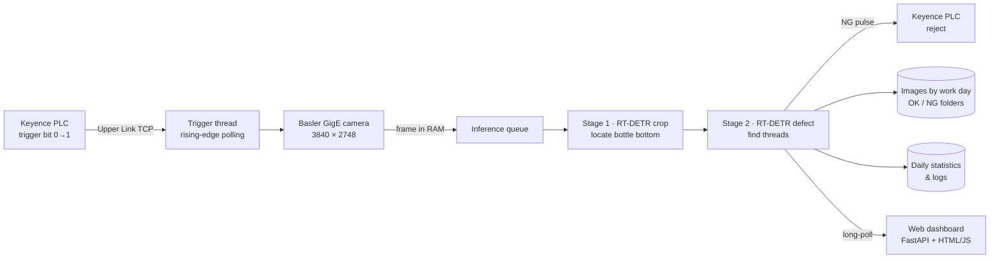

<h1 align="center">🍶 MKA-B9: Bottle-Bottom Thread Defect Inspection</h1>

<p align="center">
  <b>Two-stage RT-DETR inspection on a Jetson Orin Nano, triggered by the PLC and running 24/7 on a live production line</b>
</p>

<p align="center">
  
  
  
  
  
  
</p>

> **Note:** Built at Hondaplus Vietnam for an image inspection machine (MKA = *Máy Kiểm Ảnh*). Source code, models, production images and network details are proprietary, so this page describes the design and engineering of the system only.

---

## 📌 Problem

During molding, ultra-thin plastic **threads** (fibers) can remain on the bottom of plastic bottles. They are hard to see by eye, very small compared to the whole image, and a bottle that contains one must be rejected before packing.

The machine had to:

- Take a high-resolution photo of every bottle bottom when the PLC says the bottle is in position
- Decide **OK / NG** fast enough to keep up with the line
- Signal NG back to the PLC so the bottle is rejected
- Store every image by work shift for traceability
- Let operators, QC staff and engineers watch the line from any PC on the LAN, without the risk of anyone changing settings by accident

## 🏗️ Architecture



### Two-stage detection

1. **Crop model (RT-DETR):** locates the bottle bottom in the full 3840 × 2748 frame and crops it.
2. **Defect model (RT-DETR):** searches the cropped region for threads. Because the crop removes most of the background, the tiny defect takes up a much larger share of the model input.

The two models live in separate folders (`rt-detr-crop/`, `rt-detr-defect/`) so a crop model can never be loaded into the defect step by mistake.

## ⚙️ Engineering Highlights

### Edge inference
- **Three interchangeable backends:** PyTorch `.pth`, ONNX Runtime `.onnx` and TensorRT `.engine`, behind one interface. The web app does not need to know which one is loaded.
- **One-click TensorRT export (FP16)** from the dashboard. Each engine gets a metadata file (GPU, TensorRT version, OS, input size, class names), so moving an engine to the wrong machine gives a clear "rebuild on this device" message instead of a cryptic deserialization error.
- **Zero per-frame GPU allocation:** input/output buffers are allocated once at load time. Frames go through a pinned host buffer on a dedicated CUDA stream; BGR→RGB, HWC→CHW, normalization and post-processing (sigmoid → top-K → xyxy) all run on the GPU, and only the final boxes are copied back.
- **Training-consistent preprocessing:** resizing stays on OpenCV (`INTER_AREA`) exactly as in training, because a small preprocessing mismatch silently drops detections.

### Capture path
- **PLC-triggered capture on the rising edge (0 → 1).** A single persistent Upper Link connection is polled every 50 ms, which avoids flooding the PLC's limited connection slots. An optional auto-reset to 0 gives the ladder a "capture done" handshake.
- **"Detect directly" mode:** frame → RAM → queue → model → result pushed to the browser. This skips the old route of PNG encode, write to disk, folder scan (every 1.2 s), 0.6 s settle wait and decode for each 10 MB frame.
- **"Watch folder" mode** for external capture software: a file is processed only after its size has been stable across two checks, so half-written BMP files are never read.

### Production reliability
- **Work-day logic (06:00 → 06:00):** image folders, logs and statistics roll over at shift change, not at midnight. Counters are saved to disk, so restarting the app does not reset the day's numbers.
- **Memory stability on 24/7 runs:** limited glibc malloc arenas and an mmap threshold for large buffers stop RAM from slowly creeping up after hours of 10–30 MB frame allocations on the Jetson.
- **Camera auto-recovery:** if the camera is busy or disconnected, the app keeps retrying in the background and reports the reason on the dashboard.

### Web dashboard and access control
- **One page for the whole machine:** live image with bounding boxes, OK/NG and per-class statistics for the work day, recent NG gallery, logs, camera and PLC settings, model selection and TensorRT export.
- **Two access levels enforced on the server:** the Jetson itself (localhost) has full control. Every other PC on the LAN is **view-only**: GET requests are allowed, and only a small whitelist of harmless POSTs works (run a test detection, watch a folder, download a zip). Everything else returns `403`. Engineers can be granted edit rights by IP with `--allow-edit`.
- **Desktop launcher** for operators: one double-click starts the server, waits for the model to load and opens the dashboard.

## 🧰 Tech Stack

| Layer | Technologies |
|---|---|
| Models | RT-DETRv2 (crop + defect), trained on a custom labeled dataset (Roboflow, COCO format) |
| Inference | PyTorch, ONNX Runtime, **TensorRT 10 (FP16)**, CUDA |
| Hardware | **NVIDIA Jetson Orin Nano Super** (JetPack 6), Basler GigE camera, Keyence PLC |
| Integration | pypylon, Keyence Upper Link over TCP, SMB network share |
| Backend | Python 3.10, FastAPI, Uvicorn, OpenCV |
| Frontend | HTML, CSS, vanilla JavaScript (long-polling) |
| Ops | Bash launcher, work-day logging and statistics, 85-page user and technician manual |

## 📁 Code Organization (overview)

```
src/
├─ web_app.py          entry point
└─ mka/
   ├─ detection/       .pth / .onnx / .engine backends, TensorRT export
   ├─ workday.py       06:00 → 06:00 work-day logic
   └─ web/
      ├─ server.py     CLI options, Uvicorn startup
      ├─ access.py     view-only vs full-control access
      ├─ camera.py     Basler camera control
      ├─ camplc.py     PLC-triggered capture
      ├─ camdirect.py  in-memory "Detect directly" pipeline
      ├─ plc.py        sends results to the PLC
      ├─ daystats.py   daily statistics
      ├─ routes/       REST API (/api/...)
      └─ static/       web UI
```

## 🚀 Deployment

- Running on a live production line, with Vietnamese UI and an **85-page manual** split into an operator part and a technician part (installation, TensorRT on JetPack, network share mounting, model updates and troubleshooting)
- Model update workflow: copy the new checkpoint → export to TensorRT on the Jetson → validate on known OK/NG images → switch from the dashboard, with no code change

## 👤 Author

**Nguyen Hong Nhat Linh** – AI Engineer · [GitHub](https://github.com/LinhNhat07) · nlinh.nh7@gmail.com
